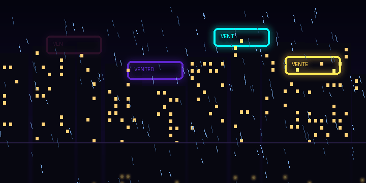
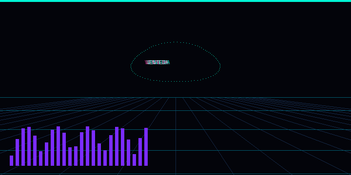
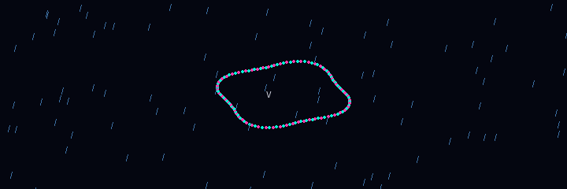
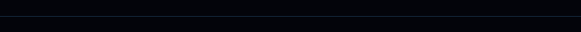

<div align="center">



<table>
<tr>
<td width="50%"></td>
<td width="50%"></td>
</tr>
</table>


<br/>

<a href="https://github.com/Armin3080"></a>
&nbsp;
<a href="https://t.me/print_001100110011"></a>
&nbsp;


</div>



<div align="center">

## ◈ OPERATOR FILE

</div>

```python
class Venteda:
    designation = "Systems Architect"
    vectors     = ["privacy nets", "local intelligence", "realtime channels", "desktop surfaces"]
    directive   = "Ship. Observe. Elevate."
    core        = "Build beyond the ordinary."
    atmosphere  = "neon · rain · midnight signal"
```

> The city never sleeps. Neither do the systems that keep it running.
> I design high-integrity networking layers, local AI cores, real-time channels and interfaces that cut through static. Only systems that survive the rain.

<div align="center">

| ▸ SECTOR | ▸ OPERATIONAL FOCUS |
|:--------:|:--------------------|
| **NETWORKING** | Encrypted channels · low-latency routes · privacy under continuous rain |
| **AI CORE** | Local LLMs · offline knowledge · inference that never leaves the node |
| **AUTOMATION** | Workflow engines · internal tools · friction deleted at source |
| **INTERFACE** | Glassmorphic HUD · neon signal design · surfaces that feel inevitable |


## ◈ ACTIVE SYSTEMS

</div>

<table>
  <tr>
    <td width="50%" valign="top">
      <h3 align="center">⚡ VENTEDA NETWORKING</h3>
      <p align="center"><code>PROTOCOL · ENCRYPT · ROUTE</code></p>
      <p align="center">Networking layer forged for privacy and speed.<br/>From interface to encrypted path — no black boxes, no leaks under rain.</p>
      <p align="center">
        
        
        
      </p>
    </td>
    <td width="50%" valign="top">
      <h3 align="center">💬 VENTEDA CHAT</h3>
      <p align="center"><code>REALTIME · LOCAL · SIGNAL</code></p>
      <p align="center">Messaging system built for presence in the dark.<br/>Local-first architecture. Neon-clear. Zero unnecessary cloud.</p>
      <p align="center">
        
        
        
      </p>
    </td>
  </tr>
  <tr>
    <td width="50%" valign="top">
      <h3 align="center">🛠 VENTEDA CRAFT</h3>
      <p align="center"><code>SURFACE · COMPONENT · HUD</code></p>
      <p align="center">Desktop launcher and interface systems dripping with neon and glass.<br/>Rapid prototyping of cinematic HUD surfaces and signal-first design.</p>
      <p align="center">
        
        
        
      </p>
    </td>
    <td width="50%" valign="top">
      <h3 align="center">🧰 DEVELOPER TOOLKIT</h3>
      <p align="center"><code>UTILITY · AUTOMATE · ACCELERATE</code></p>
      <p align="center">Internal tools forged under neon rain.<br/>Remove friction. Keep the stack sharp. Never miss a cycle.</p>
      <p align="center">
        
        
        
      </p>
    </td>
  </tr>
</table>

<div align="center">

## ◈ TECH ARSENAL


## ◈ TELEMETRY

<picture>
  <source media="(prefers-color-scheme: dark)" srcset="https://github-readme-stats.vercel.app/api?username=Armin3080&show_icons=true&theme=radical&bg_color=03040A&title_color=00F5D4&icon_color=FF3CAC&text_color=E8EAF6&hide_border=true&border_radius=14&ring_color=7B2CFF">
  
</picture>
<picture>
  <source media="(prefers-color-scheme: dark)" srcset="https://github-readme-stats.vercel.app/api/top-langs/?username=Armin3080&layout=compact&theme=radical&bg_color=03040A&title_color=00F5D4&text_color=E8EAF6&hide_border=true&border_radius=14">
  
</picture>

<br/><br/>


## ◈ UPLINK

<a href="https://github.com/Armin3080"></a>
&nbsp;&nbsp;
<a href="https://t.me/print_001100110011"></a>

<br/><br/>


<br/><br/>


<sub>▸ TRANSMISSION TERMINATED · VENTEDA SYSTEMS · 2025 → ∞ · SIGNAL HOLDS</sub>

</div>
